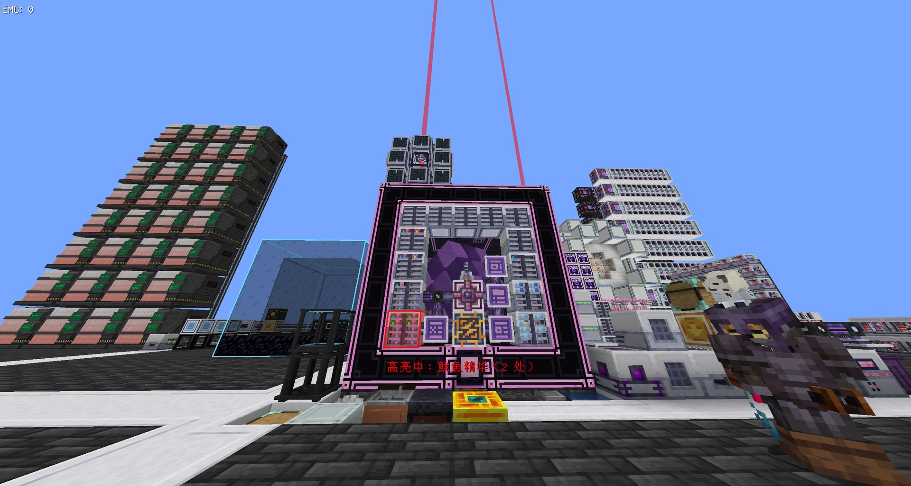
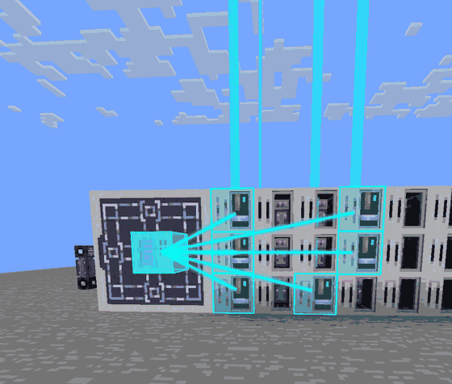
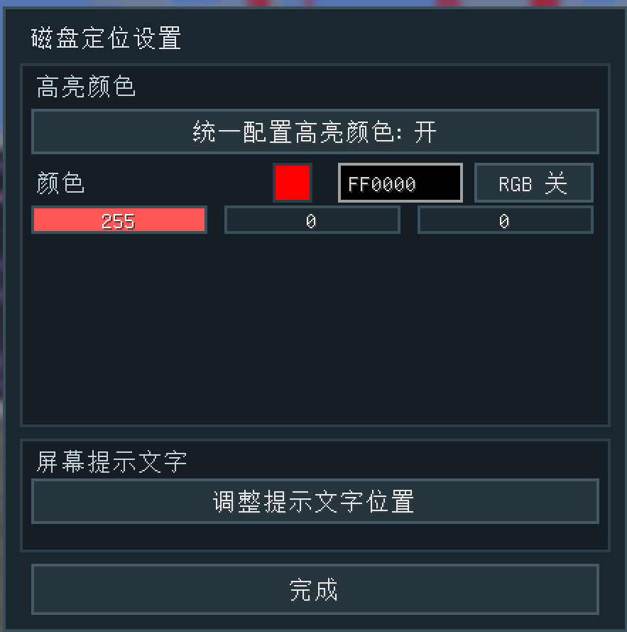
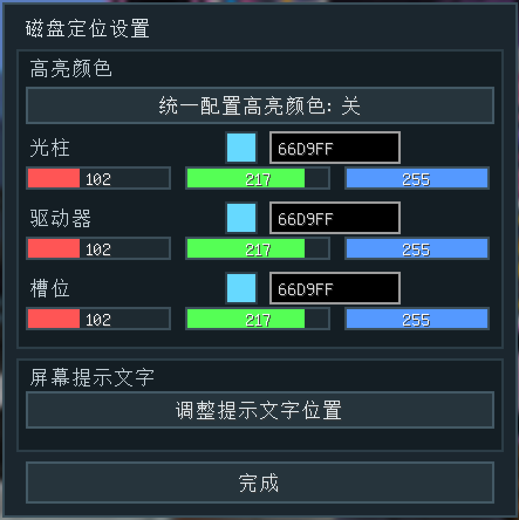

# AE2 Item Locator

**English** · [简体中文](README.zh-CN.md)

**Stop pulling disks one by one.**

In AE2, finding out which disk holds an item is manual work: the terminal shows the item, but not
where it is stored, so the only way to know is to pull disks out one at a time. This mod turns that
into a single hover — the tooltip reports the drive's coordinates and slot, and one key highlights
that drive in the world.

- No blocks, items or recipes: it only extends the terminals you already have.
- Works with vanilla drives, ME chests and addon drives, including ExtendedAE's 20-slot drive.
- Follows storage-bus bridges into subnetworks, so items reaching the main network from a subnet are
  traced to the subnet's disk.
- Supports multiblocks: a drive inside Neo ECO AE's storage subsystem host gets a link line to the
  host, and its cell is framed inside the host's own GUI.

## Features

| | |
|---|---|
| **Drive and slot in the tooltip** | Any network item gains a section listing the drive coordinates, slot number and cell type. |
| **In-world highlight** | A translucent shell, an edge outline and an optional beacon beam mark the drive. The lock persists after the terminal is closed. |
| **Slot outline** | Opening a drive outlines the slot that holds the disk. |
| **Subnetwork aware** | Storage-bus bridges are followed, and results reached through a subnet are labelled as such. |
| **Drive-agnostic** | Any implementation of AE2's `IChestOrDrive` is supported, including drives with custom slot layouts, as well as single-cell storage blocks such as Neo ECO AE's storage matrix drives. |
| **Multiblock aware** | Drives belonging to a controller get a link line to it, the controller block is highlighted as well, and the matching cell is framed inside the controller's GUI — on the correct page, with a page hint when it is not the current one. |
| **Configurable appearance** | One colour for everything, or separate beam / drive / slot colours, each with an optional rainbow cycle, plus a draggable position for the status text. |

## Screenshots

The in-game interface is available in English and Chinese; the screenshots below were taken with
Chinese selected.

<p align="center">
  
</p>

<p align="center">
  <em>Every drive holding the item, with coordinates and slot. Items reached through a subnetwork
  are marked <code>(subnet)</code>.</em>
</p>

<p align="center">
  
</p>

<p align="center">
  <em>Press <code>H</code> to lock the highlight: shell, edge outline and beacon beam, retained
  after the terminal is closed.</em>
</p>

<p align="center">
  
</p>

<p align="center">
  <em>With the rainbow cycle enabled, the beam, the highlighted blocks, the link lines and the slot
  outline share one colour and move through the hue wheel together, one turn every six seconds.</em>
</p>

<p align="center">
  
  
</p>

<p align="center">
  <em>Left: the matching slot outlined in the drive. Right: a single colour for everything, with its
  own <code>RGB</code> toggle.</em>
</p>

<p align="center">
  
</p>

<p align="center">
  <em>With "one colour" disabled, the beam, the drive highlight and the slot outline can be set
  independently — RGB sliders plus hex input, and an <code>RGB</code> toggle per row to cycle that
  colour. Changes apply immediately.</em>
</p>

## Compatibility

This branch builds for **Minecraft 1.20.1 / Forge**. The main branch targets 1.21.1 / NeoForge; the
feature set is identical apart from the Neo ECO AE integration described below.

| Minecraft | Loader | Forge | AE2 | Status |
|---|---|---|---|---|
| 1.20.1 | Forge | 47.1.3+ | 15.4.12 – 15.x | Supported |

| Minecraft | Loader | NeoForge | AE2 | Status |
|---|---|---|---|---|
| 1.21.1 | NeoForge | 21.1.169+ | 19.2.18 – 19.x | Main branch |

Requires **Applied Energistics 2** and **GuideME** (20.1.7 – 20.1.x on 1.20.1). The mod must be installed on both the client and
the server; in singleplayer this is automatic. If only one side is installed it stays inactive
instead of producing errors.

## Supported mods

Detection is generic: every block entity implementing AE2's `IChestOrDrive` is read slot by slot,
and every cell inside it is inspected regardless of which mod added that cell. The following
combinations have been verified against real mods.

| Mod | What is supported | How it is detected |
|---|---|---|
| **Applied Energistics 2** *(required)* | ME Drive (10 slots), ME Chest | native `IChestOrDrive` / `IMEChest` |
| **ExtendedAE** | Ex Drive — 20 slots, **both columns**, including the slot outline | `TileExDrive extends DriveBlockEntity` |
| **MEGA Cells** | Cell Dock, the cable-mounted cell holder | `CellDockPart implements IChestOrDrive` |
| **Neo ECO AE Extension** | `eco_drive` and its storage subsystem host: link line, host highlight, slot outline inside the controller GUI, page hint | Does not implement `IChestOrDrive`; detected through `getCellStack()` / `getCellInventory()` |
| **AE2 Things**, **MEGA Cells** bulk cells, any other cell | Located in whichever drive holds it | The drive is queried per slot, so the cell's origin is irrelevant |
| **Any other addon** providing a drive | Should work without changes | Implements `IChestOrDrive` |

Not covered:

- **Storage buses pointing at non-AE inventories** (drawers, barrels, chests). These are not drives,
  so there is no physical disk to report. The item still appears in the terminal.
- **Cell holders that neither implement `IChestOrDrive` nor follow the `getCellStack()` /
  `getCellInventory()` contract**, such as a multiblock that only exposes an aggregate storage view.
  If you encounter one, please open an issue naming the mod.

## Installation

1. Install NeoForge 21.1.169 or newer for Minecraft 1.21.1.
2. Place [Applied Energistics 2](https://modrinth.com/mod/ae2) and GuideME into `mods/`.
3. Place `ae2itemlocator-forge-1.0.0.jar` into `mods/`.

## Usage

1. Open any ME terminal and hover an item. The tooltip gains a section such as:
   ```
   Stored in 2 drive slots
     Mining Dimension (-7, 254, 27) slot 0 (subnet)
     Overworld (-14, 255, 30) slot 0
   ```
2. Press **H** (rebindable) to lock the highlight. The lock is independent of the GUI, so the
   terminal can be closed.
   - Removing the disk clears the highlight.
   - Moving it to another drive moves the highlight with it.
   - Pressing **H** again clears it.
3. Open the drive to see the matching slot outlined. If the drive is part of a multiblock
   controller, the outline appears in the controller's GUI instead, together with a page hint when
   the cell is not on the current page.
4. Press **K** (rebindable) for settings: unified or per-part colours, an `RGB` toggle per colour to
   cycle it, and the position of the on-screen status text.

## Configuration

`config/ae2itemlocator-server.toml`

| Key | Default | Description |
|---|---|---|
| `allowQuery` | `true` | Disables the feature for everyone when turned off. |
| `cellsPerTick` | `12` | Cells scanned per tick while an index is being built. Lower values are smoother but make the first lookup slower. |
| `cacheSeconds` | `10` | Upper bound on index age. Changes are detected automatically; this is only a safety net. |

`config/ae2itemlocator-client.toml`

| Key | Default | Description |
|---|---|---|
| `maxSources` | `3` | Number of drives listed in a tooltip. |
| `beam` | `true` | Draws the vertical light column. |
| `highlightSeconds` | `0` | Clears the lock after the given number of seconds; `0` keeps it until the key is pressed again. |
| `colors.unified` | `true` | Uses one colour for everything. |
| `colors.unifiedValue` | `#66D9FF` | Colour used while unified. |
| `colors.beam` / `drive` / `slot` | `#66D9FF` | Per-part colours when not unified. |
| `colors.rainbowUnified` | `false` | Cycles the unified colour through the rainbow. |
| `colors.rainbowBeam` / `rainbowDrive` / `rainbowSlot` | `false` | Cycles each part's colour when not unified. |
| `hud.x` / `hud.y` | `8` / `8` | Status text position, in permille of the screen size. |

## How it works

AE2's network storage (`IStorageService#getInventory()`) is an aggregated view by design: it does not
record where a stack came from. The drive itself is the only place that information exists, so the
mod rebuilds a "key → (drive, slot)" catalogue on the server:

```
terminal menu -> grid -> IChestOrDrive hosts -> per-slot MEStorage -> getAvailableStacks()
```

Addon drives that keep their contents in a cell item without implementing `IChestOrDrive` (Neo ECO
AE's storage matrix drives) are recognised through the `getCellStack()` / `getCellInventory()`
contract they share, and enter the same catalogue.

Building that catalogue has a cost, so it is

- sliced across server ticks (a few cells per tick) and cached per network,
- invalidated when the network's distinct key count changes,
- answered from a fresh targeted scan while a highlight is locked (250 ms), which is what allows the
  highlight to follow a disk being moved,
- extended with subnetworks reachable through a storage bus, plus a bounded positional fallback
  (drives in the loaded chunks around the network) for bridges the graph walk cannot reach.

The client only ever receives "which drives hold *this* key", never the whole index.

The controller GUI is an LDLib2 `ModularUI` rather than a vanilla container menu, so its slot
outline is drawn by a dedicated overlay: the panel's cell grid maps each `CellSlot` index to a
`CellEntry`, whose position is compared against the answer set. LDLib2's `getPositionX/Y` already
yields the absolute GUI coordinate, which is all the overlay requires.

## Known limitations

- **Storage buses onto non-AE inventories** (drawers, barrels, chests) are not drives and are not
  reported. The item remains visible in the terminal, but has no drive location.
- **Unloaded chunks** are not indexed; a drive in a chunk that nobody has loaded cannot be found.
- Highlights use normal depth testing, so a box is hidden behind walls — the beacon beam above the
  terrain is what you navigate by. Cross-dimension results are text only. The controller is the
  exception: its highlight is drawn through walls so it stays visible inside the multiblock.
- The positional fallback may report a drive from a *different* network that is built next to yours
  and happens to contain the same item. Such results are labelled as subnet results.
- **Single-cell storage blocks** (Neo ECO AE storage matrix drives) have no slot, so the tooltip
  shows the block coordinates and the cell's name instead of a slot number, and the drive-GUI outline
  does not apply — the outline appears in the controller's GUI instead.
- The controller GUI overlay reads the addon's panel classes reflectively. If that UI is
  restructured significantly, the outline will silently draw nothing rather than fail.

## Building from source

```bash
# 1. put the AE2 jar into libs/  (add GuideME if you want to run dev builds)
#    libs/appliedenergistics2-19.2.18.jar
#    libs/guideme-21.1.22.jar
# 2. build
gradle build            # or ./gradlew build
```

Output: `build/libs/ae2itemlocator-forge-<version>.jar`. No AE2 or GuideME classes are bundled.

This branch uses ForgeGradle 6 with a JDK 17 toolchain; put `appliedenergistics2-forge-15.4.12.jar` and
`guideme-20.1.15.jar` into `libs/` before building.

## License

MIT — see [LICENSE](LICENSE). Not affiliated with Team AppliedEnergistics.
