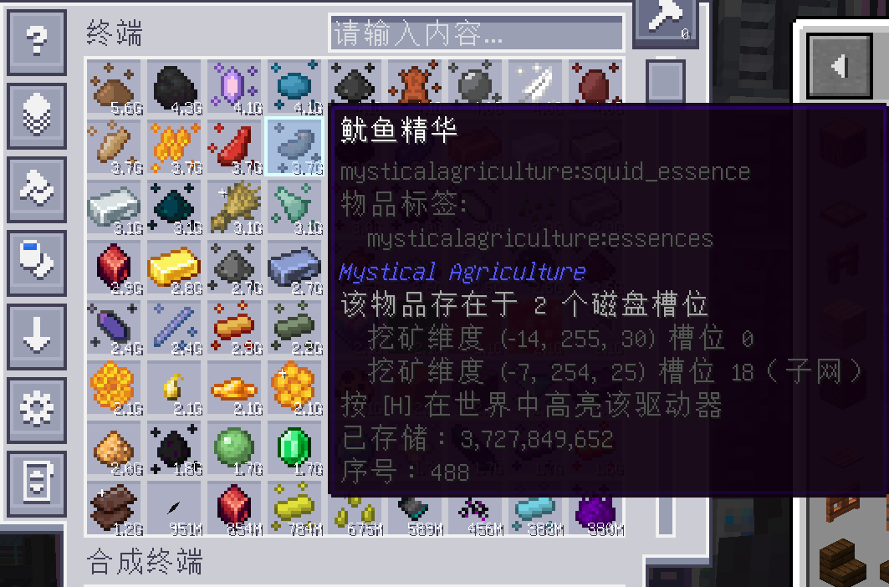
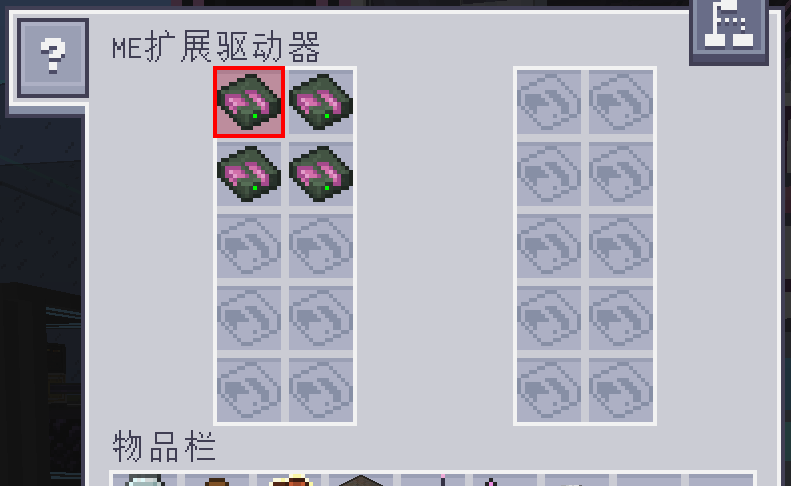

# AE2 Item Locator

**Stop pulling disks one by one.**

AE2 Item Locator answers a question Applied Energistics 2 cannot: *"which physical drive is this
item actually sitting in?"* Hover any item in any AE2 terminal and the tooltip tells you the
drive's coordinates and slot. Press one key and the drive lights up in the world — through walls,
across the base, even in another dimension.

- No blocks, no items, no recipes — it only decorates the terminals you already have.
- Works with vanilla drives, ME chests and addon drives (ExtendedAE's 20-slot drive, etc.).
- Follows storage-bus bridges into subnetworks, so items that reach your main network from a
  subnet are traced to the subnet's disk.
- Updates live: pull a disk out and the highlight disappears; plug it into another drive and the
  highlight follows within a fraction of a second.

## Features

| | |
|---|---|
| **Drive + slot in the tooltip** | Every network item gains a small section: drive coordinates, slot number and the cell type. |
| **In-world highlight** | A translucent shell, a wireframe and an optional beacon beam mark the drive. Survives closing the terminal. |
| **Slot outline** | Open the drive and the exact slot that holds the disk is outlined, so you know which disk to pull. |
| **Subnetwork aware** | Storage-bus bridges are followed; results coming from a subnet are labelled as such. |
| **Drive-agnostic** | Anything implementing AE2's `IChestOrDrive` works, including addon drives with custom slot layouts. |
| **Colours & HUD position** | Fully configurable in an in-game screen; the status text can be dragged anywhere. |

## Screenshots

<p align="center">
  
  
</p>
<p align="center">
  
  
</p>

## Compatibility

| Minecraft | Loader | NeoForge | AE2 | Status |
|---|---|---|---|---|
| 1.21.1 | NeoForge | 21.1.169+ | 19.2.18 – 19.x | Supported |

Requires **Applied Energistics 2** and its dependency **GuideME**. The mod must be installed on
**both** the client and the server (in singleplayer that is automatic). With only one side
installed it stays silent instead of erroring.

## Installation

1. Install NeoForge 21.1.169 or newer for Minecraft 1.21.1.
2. Drop [Applied Energistics 2](https://modrinth.com/mod/ae2) and GuideME into `mods/`.
3. Drop `ae2itemlocator-1.0.0.jar` into `mods/`.

## Usage

1. Open any ME terminal and hover an item.
   The tooltip gains a section like:
   ```
   Stored in 2 drive slots
     Mining Dimension (-7, 254, 27) slot 0 (subnet)
     Overworld (-14, 255, 30) slot 0
   ```
2. Press **H** (rebindable) to lock the highlight.
   The lock is independent of the GUI: close the terminal and walk to the drive.
   - Pull the disk out → the highlight disappears.
   - Put it into another drive → the highlight follows.
   - Press **H** again to clear.
3. Open the drive's GUI and the matching slot is outlined.
4. Press **K** (rebindable) for settings: colours (one for everything, or separate colours for the
   beam / drive / slot) and the position of the on-screen status text.

## Configuration

`config/ae2itemlocator-server.toml`

| Key | Default | Description |
|---|---|---|
| `allowQuery` | `true` | Turns the whole feature off for everyone when disabled. |
| `cellsPerTick` | `12` | Cells scanned per tick while an index is built. Lower = smoother, slower first lookup. |
| `cacheSeconds` | `10` | Upper bound on index age; changes are detected automatically anyway. |

`config/ae2itemlocator-client.toml`

| Key | Default | Description |
|---|---|---|
| `maxSources` | `3` | How many drive entries are listed in a tooltip. |
| `beam` | `true` | Draw the vertical light column. |
| `highlightSeconds` | `0` | Auto-clear the lock after N seconds (`0` = keep until pressed again). |
| `colors.unified` | `true` | Use a single colour for everything. |
| `colors.unifiedValue` | `#66D9FF` | Colour used while unified. |
| `colors.beam` / `drive` / `slot` | `#66D9FF` | Per-part colours when not unified. |
| `hud.x` / `hud.y` | `8` / `8` | Status text position, in permille of the screen size. |

## How it works

AE2's network storage (`IStorageService#getInventory()`) is an aggregated view: it deliberately
forgets where a stack came from. The only place that knowledge exists is the drive host itself, so
the mod rebuilds a "key → (drive, slot)" catalogue on the server:

```
terminal menu -> grid -> IChestOrDrive hosts -> per-slot MEStorage -> getAvailableStacks()
```

Because building that catalogue is not free, it is

- sliced across server ticks (a few cells per tick) and cached per network,
- invalidated when the network's distinct key count changes,
- answered from a fresh targeted scan while a highlight is locked (250 ms), which is what makes
  the highlight track a disk being moved,
- extended with subnetworks reachable through a storage bus, plus a bounded positional fallback
  (drives in the loaded chunks around the network) for bridges the graph walk cannot see.

The client only ever receives "which drives hold *this* key", never the whole index.

## Known limitations

- **Storage buses onto non-AE inventories** (drawers, barrels, chests) are not drives, so they are
  not reported. The item is still visible in the terminal, it just has no drive location.
- **Unloaded chunks** are not indexed; a drive in a chunk nobody has loaded cannot be found.
- The highlight uses normal depth testing, so the box is hidden behind walls — the beacon beam above
  the terrain is what you navigate by. Cross-dimension results are shown as text only.
- The positional fallback may list a drive from a *different* network that happens to be built right
  next to yours and happens to contain the same item. It is labelled as a subnet result.

## Building from source

```bash
# 1. put the AE2 jar into libs/  (and GuideME for dev runs)
#    libs/appliedenergistics2-19.2.18.jar
#    libs/guideme-21.1.22.jar
# 2. build
gradle build            # or ./gradlew build
```

The output is `build/libs/ae2itemlocator-<version>.jar`. No AE2 or GuideME classes are bundled.

## License

MIT — see [LICENSE](LICENSE). Not affiliated with Team AppliedEnergistics.
