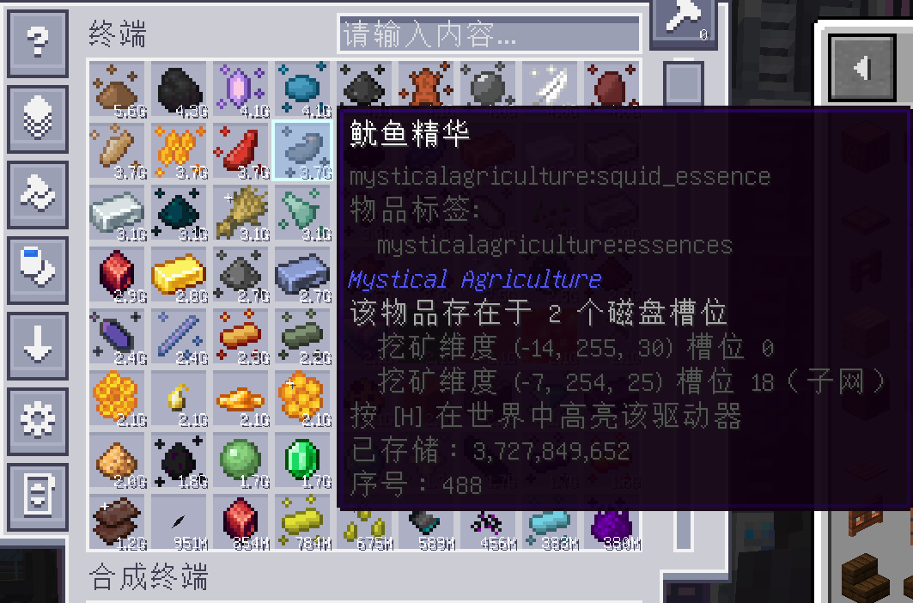
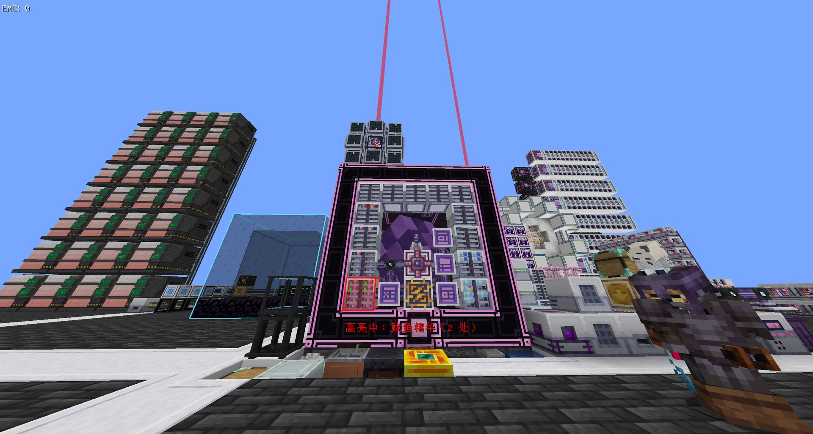
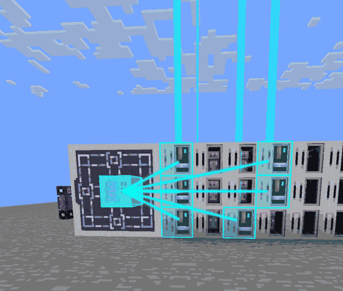
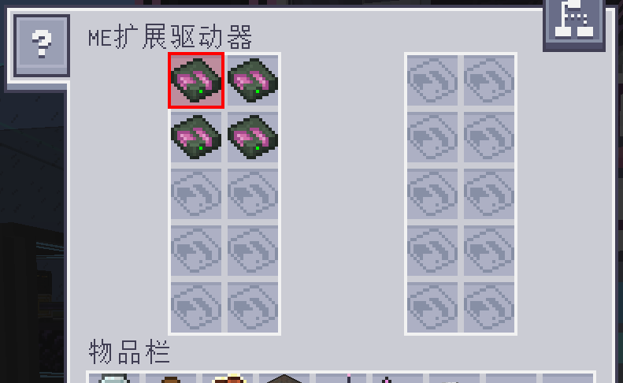
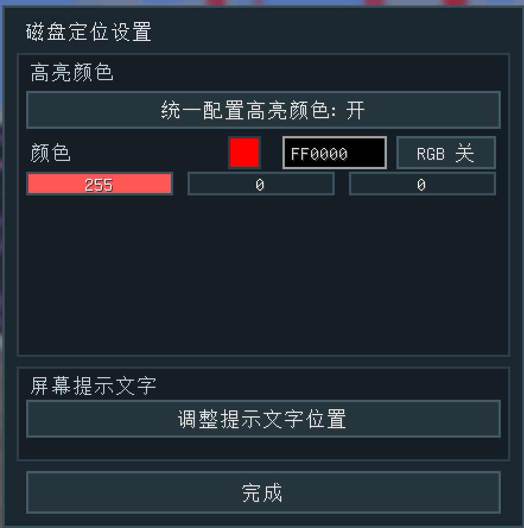
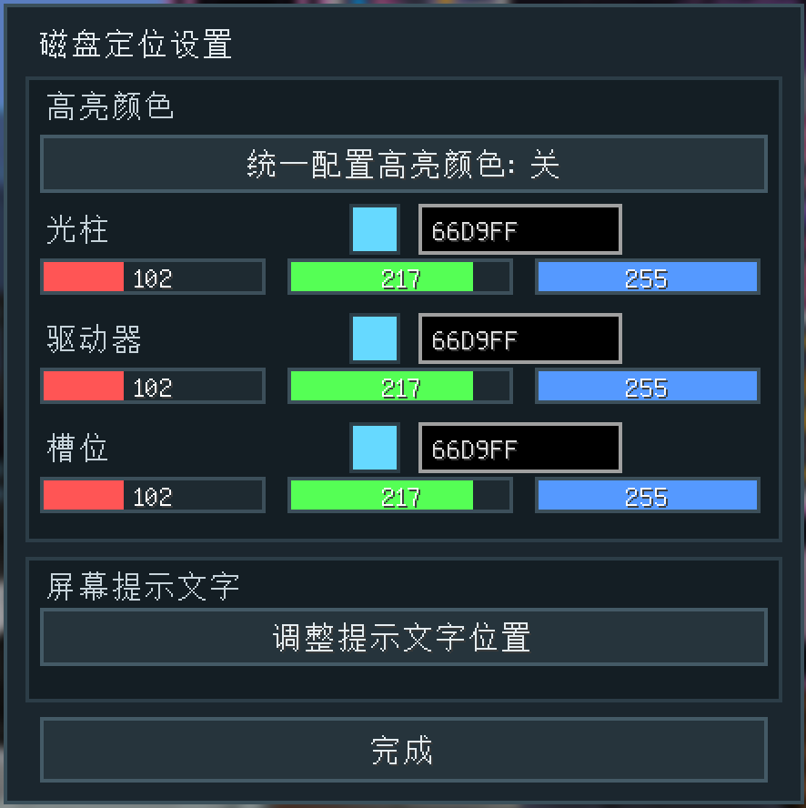

# AE2 Item Locator

[English](README.md) · **简体中文**

**别再一张一张拔磁盘了。**

这场景你应该很熟：终端里明明显示有 12000 个末地石，可它偏偏在某面墙里那堆驱动器中的某一格上。于是你
开始一个个往外拔，看提示，再塞回去。

这个模组就是来终结这套循环的。鼠标停在物品上，信息栏直接告诉你盘在哪个驱动器、第几个槽。按一下键，那个
驱动器就在世界里亮起来——穿墙、跨基地，跨维度也行。把盘拔出来，高亮跟着消失；塞进另一个驱动器，高亮
立刻跟过去。

- 不需要做任何新东西。不加方块、不加物品、不加配方，只是让现有的终端变聪明一点。
- 原版驱动器、ME 箱子、附属模组的驱动器都能用，包括 ExtendedAE 的 20 槽扩展驱动器。
- 会沿着 Storage Bus 走进子网，所以从子网跑到主网的物品，也能一路追到子网里那张盘。
- 多方块也认：装在 Neo ECO AE 存储子系统主机里的驱动器，会连一条线指向主机，对应格子还会在主机自己
  的界面里被框出来。

## 功能

| | |
|---|---|
| **它在哪** | 悬停任意网络物品，信息栏多出一段：驱动器坐标、槽位号、磁盘类型。 |
| **看得见** | 柔和的外壳、亮边，再加可选的光柱。关掉终端也不会消失。 |
| **该拔哪张盘** | 打开驱动器，对应的槽位已经被框好，不用猜了。 |
| **子网也算** | Storage Bus 的桥接会被跟着走，从子网过来的结果会标出来。 |
| **基本不挑驱动器** | 只要实现 AE2 的 `IChestOrDrive` 就行，槽位布局自己定义的附属驱动器也行；Neo ECO AE 的存储矩阵驱动器这种「单格存储方块」同样支持。 |
| **多方块也认** | 归控制器管的驱动器会画连线，控制器方块本身也亮，对应格子会在控制器界面里被框出来——在对的那一页，不在当前页时还会告诉你页码。 |
| **随你怎么配** | 颜色可以全部统一，也可以光柱 / 驱动器 / 槽位分开配，每一项都能单独开彩虹轮换；屏幕提示文字还能拖到任意位置。 |

## 截图

游戏内界面自带中英双语，下面这些是在中文环境下截的。

<p align="center">
  
</p>

<p align="center">
  <em>该物品所在的每一个驱动器、坐标和槽位都列出来了；经由子网进来的会标上
  <code>（子网）</code>。</em>
</p>

<p align="center">
  
</p>

<p align="center">
  <em>按 <code>H</code> 锁定：外壳、边框和光柱，关掉终端之后还在。</em>
</p>

<p align="center">
  
</p>

<p align="center">
  <em>开了彩虹轮换之后，光柱、方块、连线和槽位描边会一起沿色环转，六秒一圈。</em>
</p>

<p align="center">
  
  
</p>

<p align="center">
  <em>左：驱动器里对应的槽位被框出来。右：全部共用一个颜色，右边就是它自己的
  <code>RGB</code> 开关。</em>
</p>

<p align="center">
  
</p>

<p align="center">
  <em>把「统一配置高亮颜色」关掉，光柱、驱动器、槽位就能各配各的——RGB 滑条加十六进制输入，
  每一行还有个 <code>RGB</code> 开关能让它自己转起来。拖的时候就已经生效了。</em>
</p>

## 兼容性

| Minecraft | 加载器 | NeoForge | AE2 | 状态 |
|---|---|---|---|---|
| 1.21.1 | NeoForge | 21.1.169+ | 19.2.18 – 19.x | 可用 |

需要 **应用能源 2** 和 **GuideME**。客户端和服务端都要装——单人游戏本来就满足。只装一边的话它会安静
地什么都不做，不会给你刷一堆报错。

## 适配的模组

识别方式故意做得很笨很通用：只要实现了 AE2 的 `IChestOrDrive`，就逐个槽位去读，槽里的存储单元不管来自
哪个模组都会检查。下面这些是实际拿真模组测过的：

| 模组 | 能用的是什么 | 怎么认出来的 |
|---|---|---|
| **应用能源 2**（必需） | ME 驱动器（10 槽）、ME 箱子 | 原生 `IChestOrDrive` / `IMEChest` |
| **ExtendedAE** | 扩展驱动器 Ex Drive —— 20 槽，**左右两列都行**，槽位描边也支持 | `TileExDrive extends DriveBlockEntity` |
| **MEGA Cells** | Cell Dock（挂在 cable 上的单元座） | `CellDockPart implements IChestOrDrive` |
| **Neo ECO AE Extension** | `eco_drive` 和它的存储子系统主机：连线、主机高亮、控制器界面里的槽位描边、页码提示 | 它没实现 `IChestOrDrive`，走 `getCellStack()` / `getCellInventory()` 契约 |
| **AE2 Things**、**MEGA Cells** 的大宗单元，以及其他任何存储单元 | 装在哪就定位到哪 | 直接问驱动器每个槽位，跟单元来自哪个模组无关 |
| **其他任何**加了驱动器的附属 | 理论上直接能用 | 只要实现 `IChestOrDrive` |

搞不定的情况：

- **Storage Bus 对着非 AE 容器**（抽屉、木桶、普通箱子）——这些不算驱动器，物品没有对应的物理磁盘，
  自然没地方可指。物品在终端里照样能看到。
- **既不是 `IChestOrDrive`、也不符合 `getCellStack()` / `getCellInventory()` 契约的存储方块**——比如
  那种只对外提供一个聚合存储视图的多方块。真碰上了，带着模组名开个 issue。

## 安装

1. 装 NeoForge 21.1.169 或更新的版本（Minecraft 1.21.1）。
2. 把 [应用能源 2](https://modrinth.com/mod/ae2) 和 GuideME 丢进 `mods/`。
3. 把 `ae2itemlocator-1.4.1.jar` 也丢进去。

## 使用

1. 打开任意 ME 终端，鼠标停在物品上。信息栏会多出一段，大概长这样：
   ```
   该物品存在于 2 个磁盘槽位
     挖矿维度 (-7, 254, 27) 槽位 0（子网）
     主世界 (-14, 255, 30) 槽位 0
   ```
2. 按 **H**（可以改键）锁定高亮。锁定跟界面无关，关掉终端该干嘛干嘛去。
   - 把盘拔了 → 高亮消失。
   - 换到别的驱动器 → 高亮跟过去。
   - 再按一次 **H** → 取消。
3. 打开驱动器，对应的槽位已经被框住。要是这个驱动器装在多方块控制器里，就去控制器界面看——它会被框
   在那边，而且目标不在当前页时还会告诉你第几页。
4. 按 **K**（可以改键）进设置：颜色统一或分开配、每一行都能单独开 `RGB` 轮换、还能调屏幕提示文字的位置。

## 配置

`config/ae2itemlocator-server.toml`

| 键 | 默认 | 干什么的 |
|---|---|---|
| `allowQuery` | `true` | 关掉就对所有人停用。 |
| `cellsPerTick` | `12` | 建索引时每个 tick 扫几个槽位。调低更顺滑，代价是第一次查更慢。 |
| `cacheSeconds` | `10` | 索引最多能用多久再重建。内容变了本来就会自动发现，这个只是兜底。 |

`config/ae2itemlocator-client.toml`

| 键 | 默认 | 干什么的 |
|---|---|---|
| `maxSources` | `3` | 信息栏里最多列几个驱动器。 |
| `beam` | `true` | 那道竖直光柱。 |
| `highlightSeconds` | `0` | 多少秒后自动取消锁定；`0` 表示一直留着，直到你再按一次键。 |
| `colors.unified` | `true` | 全部用一个颜色。 |
| `colors.unifiedValue` | `#66D9FF` | 统一时用的颜色。 |
| `colors.beam` / `drive` / `slot` | `#66D9FF` | 不统一时各部分的颜色。 |
| `colors.rainbowUnified` | `false` | 统一颜色沿彩虹转。 |
| `colors.rainbowBeam` / `rainbowDrive` / `rainbowSlot` | `false` | 不统一时各部分沿彩虹转。 |
| `hud.x` / `hud.y` | `8` / `8` | 提示文字的位置，单位是屏幕尺寸的千分比。 |

## 实现原理

AE2 的网络存储（`IStorageService#getInventory()`）本来就是故意做成聚合视图的——它压根不记录物品从哪来。
唯一还知道这件事的是驱动器本身，所以这个模组在服务端重建了一份「物品 →（驱动器, 槽位）」目录：

```
终端菜单 -> grid -> IChestOrDrive 宿主 -> 各槽位 MEStorage -> getAvailableStacks()
```

那些把内容存在存储单元物品里、却没实现 `IChestOrDrive` 的附属驱动器（Neo ECO AE 的存储矩阵驱动器就是），
则通过它们共有的 `getCellStack()` / `getCellInventory()` 契约认出来，一样进目录。

建这份目录是要花时间的，所以：

- 摊到多个服务端 tick 里做（每 tick 扫几个槽），并按网络缓存；
- 网络里「不同物品数量」一变就失效；
- 锁定高亮期间改成**按单个物品的定向扫描**来回答（250 ms 一次），这也是高亮能跟着磁盘跑的原因；
- 还会顺着 Storage Bus 走进子网，再加一层**有界的按位置扫描**兜底（扫网络周围已加载区块里的驱动器），
  把图遍历够不到的桥接方式补上。

客户端收到的永远只是「这个物品在哪些驱动器里」，拿不到整份索引。

控制器界面是 LDLib2 的 `ModularUI`，不是原版容器菜单，所以槽位描边由一层专门的覆盖绘制来做：面板的
格子网格会把每个 `CellSlot` 的序号映射到 `CellEntry`，再拿条目坐标跟结果集比对。LDLib2 的
`getPositionX/Y` 本身就是屏幕绝对坐标，覆盖层要的就是这个数。

## 已知限制

- **Storage Bus 对着非 AE 容器**（抽屉、木桶、箱子）不算驱动器，不会出现在结果里。物品在终端里还看得见，
  只是没有磁盘位置可指。
- **没加载的区块**不进索引。没人加载过的区块里那张盘，找不到。
- 高亮用的是正常深度测试，被墙挡住就是挡住——真正用来导航的是升到地表以上的光柱。跨维度的结果只给文字。
  控制器是个例外：它的高亮是穿透画的，所以在多方块内部也看得见。
- 按位置兜底有可能列出**另一张网络**里的驱动器（前提是它正好建在你基地旁边，还恰好也有同一个物品），
  这类结果会被标成子网。
- **单格存储方块**（Neo ECO AE 存储矩阵驱动器）没有槽位概念，信息栏里显示的是方块坐标和存储单元名称而不是
  槽位号；驱动器界面的槽位描边对它也不适用——描边会出现在控制器界面里。
- 控制器界面的覆盖层是反射读取附属模组面板类的。那边要是把 UI 结构大改，描边会悄悄什么都不画，而不是崩
  游戏。

## 从源码构建

```bash
# 1. 把 AE2 的 jar 放进 libs/（想跑开发环境再加 GuideME）
#    libs/appliedenergistics2-19.2.18.jar
#    libs/guideme-21.1.22.jar
# 2. 构建
gradle build            # 或者 ./gradlew build
```

产物在 `build/libs/ae2itemlocator-<版本>.jar`，不会打包任何 AE2 或 GuideME 的类。

## 许可

MIT，见 [LICENSE](LICENSE)。和 Team AppliedEnergistics 没有隶属关系。
